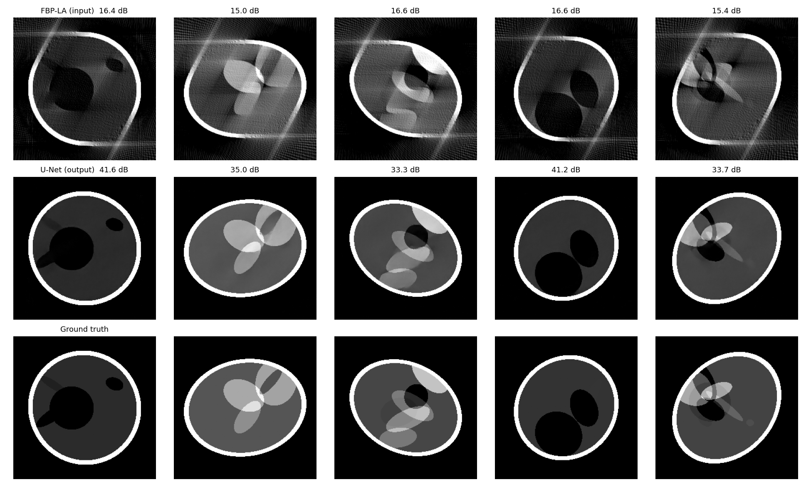
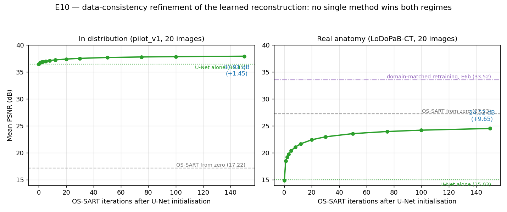

# Deep Learning for Limited-Angle X-ray CT

Code and results for my MSc dissertation, *Deep Learning for Limited-Angle X-ray
Computed Tomography: Characterising the Reach and Limits of a Learned
Post-Processing Reconstruction* (MSc Artificial Intelligence for Engineering and
Design, University of Bath, September 2026). Supervisor: Prof. Manuchehr
Soleimani.

## Overview

Limited-angle CT arises when a scanner cannot rotate through the full angular
range, as in dental and C-arm systems. Filtered Back Projection (FBP) on this
incomplete data gives images with streaks and missing edges.

This project trains a residual U-Net (FBPConvNet, Jin et al., 2017) to remove
those artefacts from the FBP image. The scan is a 2D parallel-beam protocol at
256x256 with 60 projections over a 120 degree wedge, simulated with the
[TIGRE](https://github.com/CERN/TIGRE) toolbox. Ten experiments then measure where the method works and where it fails. They
cover angular severity, noise, training set size, unseen shapes, real anatomy
from LoDoPaB-CT and a combination with iterative reconstruction.



## Main results

PSNR in dB on the held-out validation split (80 images) unless stated. Every
number below can be traced to a `*_summary.json` file in `training/runs/` or to
a table in `logs/`.

| Experiment | Setting | Result |
|---|---|---|
| Baseline | 120 degrees, 800 pairs, seed 42 | FBP 15.94, OS-SART 17.22, U-Net 36.45 (SSIM 0.388 to 0.960) |
| Seed repeats | seeds 42, 43, 44 | U-Net 36.77 +/- 0.30 |
| Classical comparison | held-out Shepp-Logan phantom | FBP 21.72, OS-SART 26.68, U-Net 17.48 |
| Residual ablation | no residual connection | U-Net 36.89 |
| Noise, first run | Poisson noise on the original attenuation scale | Invalid. `diagnose_noise.py` shows the photon starvation that caused it. Replaced by the noise study |
| Angular severity | 90 and 150 degree wedges, retrained | 33.43 and 40.79 |
| Severity transfer | 120 degree model on 90 and 150 degree data | 16.57 and 20.75 |
| Training set size | 200, 400, 800, 1600 training pairs | 33.08, 35.24, 36.45, 38.93 |
| Real-data test | ellipse-trained model on 300 LoDoPaB-CT slices | FBP 18.10, OS-SART 27.23, U-Net 15.03 |
| Real-data training | trained on LoDoPaB-CT, fine-tuned and from scratch | 33.26 and 33.52. The fine-tuned model drops to 18.12 on the original phantoms |
| Noise study | physical attenuation scale, retrained at I0 = 1e6, 1e5, 1e4 | 37.40, 35.43, 33.09 (noiseless 36.67) |
| Noise transfer | noiseless model on I0 = 1e6, 1e5, 1e4 | 37.11, 35.54, 24.37 |
| Angle patterns | 120 degrees of coverage split into different patterns | one 60 degree gap 37.15, 3x20 degree gaps 38.01, 6x10 degree gaps 38.19 |
| Unseen shapes | squares and triangles added to the phantoms | ellipse-trained 35.30, shapes-trained 36.21 |
| Hybrid reconstruction | OS-SART iterations started from the U-Net output (20 images) | phantoms 36.46 to 37.91, LoDoPaB-CT 14.87 to 24.52 |

The short version is that the network works well inside its training
distribution and fails outside it without any visible warning. On real anatomy
the ellipse-trained model scores below its own FBP input on every one of the
300 slices while still producing clean-looking images. Training on matched data
fixes this. Adding iterative steps after the network repairs part of the
failure, but on real data it stays below OS-SART run from zero (27.23), so no
single method wins in both cases.



## Repository layout

```
limited_angle_demo.py      baseline: Shepp-Logan under full and limited angle
generate_dataset.py        synthetic phantom generator (ellipses or mixed shapes)
build_lodopab_dataset.py        builds the LoDoPaB-CT evaluation and training sets
diagnose_noise.py          post-mortem on the first noise run
reconstruct_hybrid.py      U-Net prior combined with OS-SART
collect_*_results.py       gather run summaries into the tables in logs/
training/                  model, dataset, metrics, training and evaluation scripts
training/runs/             one folder per run: config, metrics, curves, figures
analysis/                  figure scripts and the figures used in the dissertation
scripts/                   Windows batch files that ran each experiment queue
logs/                      console logs and result tables from the actual runs
data/                      meta.json for every dataset (the data itself is not stored)
```

`training/README.md` and `training/DOCUMENTATION.md` describe the training code
in more detail.

## Setup

The work was done on Windows with Python 3.10, a CUDA 12.1 build of PyTorch and
a single RTX 4090.

1. Install PyTorch for your GPU from pytorch.org.
2. `pip install -r requirements.txt`
3. Build TIGRE from source by following the instructions in the
   [TIGRE repository](https://github.com/CERN/TIGRE). This project used commit
   `ab0bd51`.

TIGRE is only needed for data generation and the scripts that run classical
reconstructions (`generate_dataset.py`, `build_lodopab_dataset.py`,
`training/evaluate_classical.py`, `reconstruct_hybrid.py`). Training and the standard
evaluation need PyTorch only.

## Reproducing the baseline

Run everything from the repository root.

```
python limited_angle_demo.py
python generate_dataset.py --n 800 --out data/pilot_v1
python training/train_unet.py --epochs 100 --batch-size 16 --amp
python training/evaluate_unet.py --run training/runs/<run-name>
```

One training run takes about 45 minutes on the RTX 4090.

## Experiments and the scripts that ran them

The batch files expect a conda environment called `tigre` and change to the
repository root themselves, so they can be started from anywhere.

| Experiment | Batch file | Run folders in `training/runs/` | Dissertation label |
|---|---|---|---|
| Classical comparison | `scripts\run_experiments.bat` | `20260622_154318\classical_summary.json` | E1 |
| Residual ablation | `scripts\run_experiments.bat` | `ablation_no_residual` | E2 |
| Noise, first run | `scripts\run_experiments.bat` | `noise_unscaled_i0_1e5` | E3 |
| Angular severity | `scripts\run_experiments.bat` | `severity_90deg`, `severity_150deg` | E4 |
| Training set size | `scripts\run_experiments.bat`, `scripts\run_week2.bat` | `datasize_n200`, `datasize_n400`, `datasize_n1600` | E5 |
| Real-data test | `scripts\run_lodopab_test.bat` | `20260622_154318\lodopab_summary.json` | E6 |
| Real-data training | `scripts\run_lodopab_training.bat` | `lodopab_finetune`, `lodopab_scratch` | E6b |
| Noise study | `scripts\run_noise.bat` | `noise_noiseless`, `noise_i0_1e6`, `noise_i0_1e5`, `noise_i0_1e4` | E7 |
| Angle patterns | `scripts\run_week2.bat` | `gap30`, `gap60`, `multigap3x20`, `multigap6x10`, `offset45`, `offset90` | E8 |
| Unseen shapes | `scripts\run_shapes.bat` | `shapes800`, `xeval\base_on_shapes`, `xeval\shapes_on_pilot` | E9 |
| Hybrid reconstruction | `scripts\run_hybrid.bat`, `scripts\run_hybrid_sweep_deep.bat` | `hybrid` | E10 |
| Seed repeats and transfer tests | `scripts\run_week2.bat` | `baseline_seed43`, `baseline_seed44`, `xeval\*` | |

The baseline run keeps its original timestamp name, `20260622_154318`. In
`lodopab_finetune`, `eval_summary.json` holds the forgetting test on the
original phantoms and `lodopab_summary.json` holds the LoDoPaB-CT score.

The experiments were labelled E1 to E10 during the project and the dissertation
uses those labels. In this repository the files, folders, scripts and logs use
descriptive names, and the last column of the table maps them back. Titles
inside some of the saved figures still show the old labels.

## What is not in the repository

- The datasets (about 15 GB). They can be regenerated, see `data/README.md`.
- The model checkpoints (about 124 MB per run). Retraining reproduces them.
- TIGRE itself, which is installed separately.

The batch files were moved into `scripts/` for this repository and their paths
were updated to match. In the logs and run configs, the absolute folder path of
my machine was replaced with `.` and the experiment labels were renamed as
described above. No results were changed.

## Acknowledgements

Thank you to Prof. Manuchehr Soleimani for supervising the project and for the
introduction to TIGRE.

The real CT slices shown in the figures and used in the real-data experiments
come from the LoDoPaB-CT dataset (Leuschner et al., 2021). This repository
contains information from LoDoPaB-CT, which is made available under the ODC
Attribution License (ODC-By) v1.0. LoDoPaB-CT is built on the LIDC-IDRI
collection hosted by The Cancer Imaging Archive, which is published under the
Creative Commons Attribution 3.0 Unported licence (Armato et al., 2011, Clark et
al., 2013).

As declared in the dissertation, Claude was used as an assistive tool for coding
support on the experiment scripts. It was not used to fabricate or analyse any
results or data.

## References

- Jin, K.H., McCann, M.T., Froustey, E. and Unser, M. (2017) 'Deep convolutional
  neural network for inverse problems in imaging', *IEEE Transactions on Image
  Processing*, 26(9), pp. 4509-4522.
- Biguri, A., Dosanjh, M., Hancock, S. and Soleimani, M. (2016) 'TIGRE: a
  MATLAB-GPU toolbox for CBCT image reconstruction', *Biomedical Physics and
  Engineering Express*, 2(5), 055010.
- Leuschner, J., Schmidt, M., Baguer, D.O. and Maass, P. (2021) 'LoDoPaB-CT, a
  benchmark dataset for low-dose computed tomography reconstruction',
  *Scientific Data*, 8, 109.
- Armato, S.G. et al. (2011) 'The Lung Image Database Consortium (LIDC) and
  Image Database Resource Initiative (IDRI): a completed reference database of
  lung nodules on CT scans', *Medical Physics*, 38(2), pp. 915-931.
- Clark, K. et al. (2013) 'The Cancer Imaging Archive (TCIA): maintaining and
  operating a public information repository', *Journal of Digital Imaging*,
  26(6), pp. 1045-1057.

## Licence

Copyright (c) 2026 Omar El Attar. No open-source licence has been applied yet,
so all rights are reserved for now.
